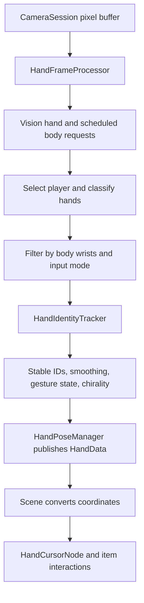

# Hand tracking and gestures

## From a camera frame to a cartoon cursor

`HandCursorNode` is a visual consumer. It does not run Vision, identify the player, or choose which item to grab.

## Frame processing order

`HandFrameProcessor.process` runs a hand-pose request each processed frame. Body detection runs on its configured cadence, currently every third frame. It updates the player selection, classifies every usable hand, filters hands against the selected body's wrists and the chosen hand mode, and then updates the identity tracker.

Current limits are four Vision hand candidates, up to two playable hands, and joint confidence at least `0.25`. A classification needs a reliable wrist and at least one usable knuckle measurement with a positive palm length. A missing selected body still prevents new accepted hand input. The `tracksSinglePlayer` flag is not currently a complete bypass: the later selected-player guard still exists.

Continuing readings near an existing track can survive a failed body-wrist match. The body wrist may be stale between body requests; this rescue avoids freezing a fast-moving hand that has already been associated with the player.

## What the classifier measures

The cursor is the average of the wrist and available index, middle, ring and little MCP knuckles. Fingertips are excluded from that average so closing a pinch does not move the cursor simply because fingers curled.

Palm length is the largest available wrist-to-knuckle distance. Measurements scale x by camera width/height so horizontal and vertical distances use consistent units. Published positions remain normalized Vision coordinates.

The pinch ratio is thumb-tip to index-tip distance divided by palm length. The grab point is the midpoint of those fingertips, falling back to the palm when either is absent. Skeleton chains contain available joints for each finger. Finger geometry is calculated only when the selected gesture needs it.

## Stable identities and movement

Vision observation order is not a hand identity. `HandIdentityTracker` greedily matches each reading to the nearest unclaimed previous smoothed position inside `matchRadius`. New tracks receive increasing integer IDs. These IDs key cursor nodes and held items.

| Dial | Current value | Effect |
|---|---:|---|
| `cursorSmoothing` | 0.5 | Fraction of the new position gap applied per tracking update |
| `matchRadius` | 0.45 | Maximum normalized distance for matching an existing track |
| `continuationRadius` | 0.1 | Tighter radius used to rescue a continuing hand |
| `gracePeriod` | 0.35 s | Keep an unmatched hand published at its previous location |

Smoothing is `previous + (reading - previous) × factor`. It intentionally creates trailing motion. Because this factor is per processed reading, its real-time feel depends on tracking frequency. A scene rendering more frequently does not undo this latency.

Unmatched but unexpired tracks coast: their last position, skeleton, chirality and committed grip stay published. An expired track is removed; a later detection receives a fresh ID. Nearest-neighbor identity can still be ambiguous when hands cross closely. Chirality currently controls appearance, not the matching algorithm.

## Gesture state is more than a Boolean

The names `isClosedFist` and `isOpenHand` are retained data-interface names. They mean selected grip active and selected grip neutral, not a general-purpose fist/open-palm classifier.

`GestureDetector` keeps three states: neutral, active and uncertain. A missing measurement while previously active produces uncertainty; it should not be treated as a deliberate release. The detector uses different closing/opening thresholds to avoid flicker at the boundary.

| Gesture rule | Current value |
|---|---:|
| Pinch close ratio | ≤ 0.30 |
| Pinch open ratio | ≥ 0.40 |
| F-Pinch close/open ratios | ≤ 0.23 / ≥ 0.35 |
| Minimum agreeing evidence time | 0.05 s |
| Minimum evidence count | 1, plus the time requirement |
| Maximum gap before detector reset | 0.15 s |
| Uncertain grip timeout | 0.25 s |

F-Pinch also requires a non-extended index finger and all three supporting fingers mostly extended. Release can be established by a sufficiently open pinch or by the supporting-finger rule. Missing necessary geometry cannot vote reliably. On a completely missing hand frame, coasting preserves the committed grip but clears unfinished evidence.

Changing the saved gesture resets detectors; evidence gathered for Pinch must not activate F-Pinch accidentally.

## Chirality and artwork

`HandClassifier` copies `observation.chirality`. The tracker remembers the last known value for each hand ID and ignores `.unknown` updates. Once calibration locks onto the player (`keepsHandSides`), a hand keeps the side it already has, so a misread flip can't flip its art; a hand lost and found again gets a new ID and is read afresh. `HandData` carries that remembered value to both scenes. Cursor updates also preserve existing orientation when given unknown chirality. Screen position no longer decides left/right.

The **current code** uses `xScale = 1` for `.left` and `-1` for `.right` (`HandCursorNode.artMirror`, shared with the SwiftUI hand pointers); the pinch-offset mirror follows that convention. Some comments still describe the opposite mirroring. Use the assignments and test the actual mirrored camera feed when replacing art.

Cursor artwork is square, sized to `bubbleRadius × 2.5`. Its palm anchor is `(0.49, 0.425)`, and the drawn pinch location is `(0.05, 0.60)`. Held-item position is cursor position plus the scaled/mirrored difference between those two points. The node briefly changes scale on grip changes, swaps open/pinch textures, and fades away over 0.25 seconds after the tracker stops publishing it.

A newly unknown node retains the sprite's default scale; the pinch helper treats non-left chirality using its other mirror branch. Check that initial-unknown appearance if artwork placement looks inconsistent before the first known reading. The held-item offset also does not include the node's transient pop scale.

## Pressing buttons by pinching

Story reports and Buffet rules, round breaks, and reports keep hand tracking active and opt in with `acceptsHandClicks()`. Each enabled `ClickButton` offers its bounds through the `HandClickTargets` preference. `HandPointerLayer` draws the hand, highlights the button underneath, and presses it when a pinch **starts** over it. `PinchClickDetector` counts at most one press per frame. A held pinch, a pinch dragged onto a button, or a hand that appears already pinching does not press a button. Tapping uses the same button action.

The manual pause menu uses touch controls. Opening it suspends Vision and clears the cursors while the camera session stays ready. Resume restores detection with the existing calibration. Retry from the report or the pause menu closes the old kitchen and starts a fresh seat calibration.

## Scene interaction and troubleshooting

Scenes read `HandInputSource`, map the cursor/joints into scene space, update the cursor by hand ID, then apply gameplay-specific grabs and release rules. Food has a second smoothing layer in the scene. Kitchen and classic unknown-grip behavior are not identical; consult their guides before changing a shared field.

If no hand appears, check camera authorization, player body selection and wrist filtering before artwork. If a cursor freezes briefly, inspect coasting logs. If motion trails, inspect tracking frequency and cursor smoothing before increasing render FPS. If orientation is wrong, inspect the chirality value and current mirrored artwork convention.

## Source map and tests

- [Frame pipeline](../../PlayFeat/Vision/HandFrameProcessor.swift)
- [Classifier](../../PlayFeat/Vision/HandClassifier.swift)
- [Identity tracker](../../PlayFeat/Vision/Gestures/HandIdentityTracker.swift)
- [Gesture detector](../../PlayFeat/Vision/Gestures/GestureDetector.swift)
- [Finger geometry](../../PlayFeat/Vision/Gestures/GestureGeometry.swift)
- [Published hand model](../../PlayFeat/Vision/HandData.swift)
- [Cursor node](../../PlayFeat/Scenes/Nodes/HandCursorNode.swift)
- [Pinch presses](../../PlayFeat/Vision/Gestures/PinchClickDetector.swift), [hand-pressable buttons](../../PlayFeat/UI/Components/Button/HandClickTarget.swift), [hand pointers](../../PlayFeat/UI/Overlays/HandPointerLayer.swift)
- [Identity tests](../../Testing/PlayFeatTests/Vision/Gestures/HandIdentityTrackerTests.swift)
- [Gesture tests](../../Testing/PlayFeatTests/Vision/Gestures/GestureDetectorTests.swift)
- [Cursor tests](../../Testing/PlayFeatTests/Scenes/Nodes/HandCursorNodeTests.swift)

Related: [camera](02-camera-and-coordinate-mapping.md), [calibration](04-calibration-and-player-selection.md), [kitchen interaction](06-kitchen-items-and-interactions.md). [Back to index](README.md).
