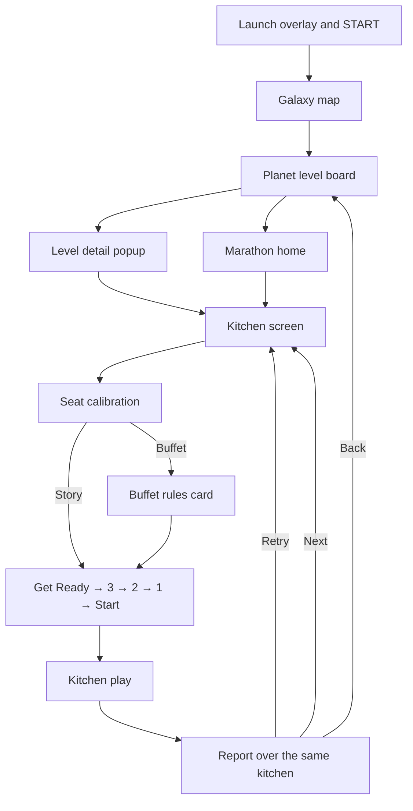

# Menus and navigation

## Routes versus overlays

`AppScreen` is an enum of full-screen destinations. `ContentView.currentScreen` switches over it; there is no navigation stack to pop. `SceneManager` methods choose explicit destinations. Back buttons therefore call a known route rather than a generic history operation.

Popups, calibration, countdowns and reports are often **inside** a screen. Showing one does not necessarily change `AppScreen` or destroy the scene underneath.

## Current primary flow

The underlying initial route is `.galaxy`. `LaunchView` sits over it until Start removes the overlay. Its two-second loading bar is timer-driven presentation; it is not awaiting a real loading job.

## Full-screen route map

| AppScreen | View | Current role |
|---|---|---|
| `.galaxy` | `GalaxyMapView` | Current first destination after Start |
| `.planetSelect` | `PlanetSelectView` | Kepler levels, shop/recipe popups and marathon entry |
| `.kitchen(level)` | `KitchenView` | Story day or active marathon kitchen |
| `.marathon` | `MarathonView` | Marathon trophy, best score and leaderboard |
| `.mainMenu` | `GameOpening` | Retained classic main menu |
| `.gameplay` | `GameplayView` | Retained classic recipe/plate game |
| `.shop` | `ShopView` | Retained multiplier shop |
| `.postGame(result)` | `PostGameView` | Retained classic paycheck screen |

`OnboardingView` and `SplashScreenView` still exist, but the current `ContentView` does not mount them. Some file comments and the root README describe an older startup flow; adding those views back requires actual route/composition work.

## Kitchen presentation state

A kitchen visit owns calibration state, countdown, pause/settings visibility, and Buffet overlay state. Its `KitchenDay` is separate from those presentation decisions.

For a story visit the screen loads owned tool counts and upgraded ingredient pricing. For marathon it reuses `SceneManager.marathon.day`. Both prepare a new scene, inject hands and audio, and start the camera.

Story visits start the countdown after calibration. Buffet opens a short rules card before the countdown on each run. Players can tap or pinch Continue to dismiss it early.

Kitchen guides highlight live ingredients, tools, and customers. Accepted drops and serves advance the matching steps, and hints persist across visits. In the default mode, clearing a story level with at least one star hides its guides on later attempts. **Always Show Tutorial** in Settings makes guides available again at the start of each attempt. Story levels still unlock their associated recipe-book pages when play begins. Long-press the settings gear on the planet board and select **New Visitor** to reset tutorial progress while keeping recipe unlocks, scores, and purchases.

## Pause, restart and background return

`StopButtonLayer` uses a full-screen transparent tap catcher. Tapping reveals a Stop control temporarily; it auto-hides after five seconds. In the kitchen, Stop pauses the day and opens `PausePopup` with Resume, Restart, Settings and Home actions. Home returns to level selection. Restart constructs a fresh story visit or a fresh entire marathon run.

This differs from the classic Stop action, which follows its own quit/game-over path. Do not apply classic button behavior to the kitchen simply because the control looks similar.

A background return can run another countdown before resuming. A brief inactive interruption can resume without it. Ended days do not resume on foreground entry. See the lifecycle guide for camera and rendering suspension.

## Story postgame remains in-game

`SceneManager.showReport` stores a `LevelReport` without changing `screen`. `KitchenView` draws `LevelReportView` above the kitchen and pauses rendering when the day is over.

- Back calls `goToPlanetSelect`, which clears the report.
- Retry calls `goToKitchen` with the same level.
- Next loads the following configured Kepler level; after the last level, it returns to the board.

`SceneManager` routes Retry and Next through `.kitchenHandover`. `ContentView` removes the outgoing kitchen and shows a black screen during teardown. The next kitchen mounts with a fresh `KitchenDay`, scene, and seat calibration. Stars reveal with chimes in the report.

## Recipe book and shared chrome

The recipe book is an overlay on the level board. Its four actual entries describe baked bread and the three dishes. Six tile slots are drawn, with unused slots locked. Actual entries are selected directly; this is not currently a level-gated recipe discovery collection. Descriptions still include placeholder copy.

`PlanetScreen` supplies the shared top counters/settings overlay and starts home music on appearance. `ClickButton` is the shared sound-producing button wrapper. Popup containers such as `SunrisePopupOverlay` and `ReportPopup` handle the visual shell; the owning screen supplies actions.

## Where to change behavior

Change route ownership in `SceneManager`, screen composition in `ContentView`, and local overlays in their owner. Keep Back/Next/Retry decisions explicit and test them. Navigating away destroys local view state; storing a report while leaving the route unchanged preserves the kitchen background.

## Source map and tests

- [Route enum](../../PlayFeat/App/AppScreen.swift), [route methods](../../PlayFeat/App/SceneManager.swift), [root switch](../../PlayFeat/UI/Screens/ContentView.swift)
- [Launch](../../PlayFeat/UI/Screens/LaunchView.swift), [kitchen flow](../../PlayFeat/UI/Screens/KitchenView.swift)
- [Pause popup](../../PlayFeat/UI/Overlays/PausePopup.swift), [hidden Stop control](../../PlayFeat/UI/Overlays/StopButtonLayer.swift)
- [Kitchen guide](../../PlayFeat/Scenes/KitchenScene/Tutorial.swift), [tutorial progress](../../PlayFeat/Game/Level/TutorialProgress.swift), [recipe book model](../../PlayFeat/Data/Models/RecipeBook.swift)
- [Story report](../../PlayFeat/UI/Overlays/LevelReportView.swift), [classic report](../../PlayFeat/UI/Screens/PostGameView.swift)
- [Navigation tests](../../Testing/PlayFeatTests/App/SceneManagerTests.swift), [recipe-book tests](../../Testing/PlayFeatTests/Data/Models/RecipeBookTests.swift)

Related: [architecture](01-architecture-and-app-lifecycle.md), [planets](08-planets-and-progression.md), [classic game](15-classic-game-mode.md). [Back to index](README.md).
