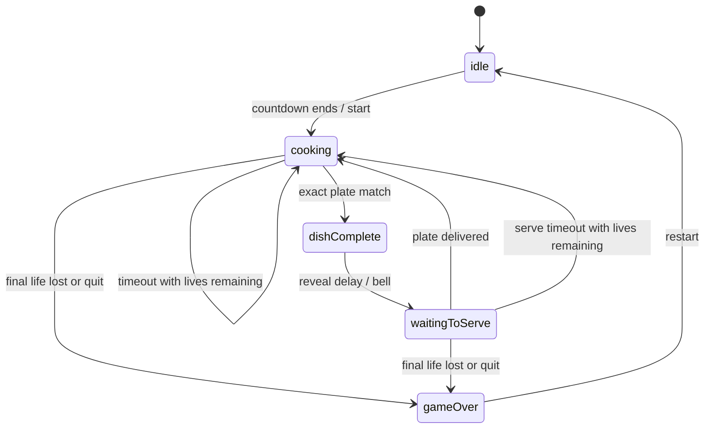

# Classic game mode

## Why this code is still here

`GameplayView`, `GameStateManager`, `GameScene`, the classic `Recipe`/`Ingredient` catalog and `PostGameView` implement the earlier camera-background cooking game. They remain reachable through legacy routes and the planet board's story-load fallback.

This engine does not use `KitchenDay`, customer queues, grilled flatbread recipes or star-target levels. Its timer, event log and economy must be understood separately from the current planet kitchen.

## State machine



The actual waiting state carries its `bellSide`; the bell cannot be waiting without a direction. Pause is an independent flag, not another game phase.

## Setup and clocks

The screen creates a fresh manager and scene, attaches `GameAudio`, and connects hand input. Tutorial/calibration/countdown are screen phases. The camera and cursor scene can remain mounted through them while the plate/bin are hidden until `showsBoard` is enabled.

The manager starts with three lives by default and uses a 30-Hz timer. `PlayClock` tracks unpaused elapsed time, capped to 0.25 seconds per tick. `Countdown` stores deadlines on that play clock. The HUD receives whole-second elapsed updates, while timer fractions are read without publishing every internal tick.

There are two deadlines: assembly while cooking, and a five-second serving window after the bell. The 0.9-second finished-dish reveal happens before the serving deadline starts. Some older recipe comments say serving is untimed; the manager's actual five-second countdown is authoritative.

## Recipes and matching

The catalog includes Chicken Mayonnaise, Chicken Cheese, Salad and Chicken Geprek, with base assembly limits of 13, 13, 23 and 18 seconds respectively. `RecipeDeck` picks a random initial recipe and avoids immediately repeating the same recipe when alternatives exist.

Matching is an exact **multiset** comparison. Plate count and ingredient multiplicities must match the recipe; set equality alone would incorrectly accept duplicated or missing ingredients. A wrong ingredient remains detectable from current plate contents.

## Scene interaction

`GameScene` polls manager state and reads every new numbered event. Its input extension maps hand joints into scene space, updates cartoon cursors before game-state gates, selects touched ingredients on grip activation, eases held food toward the drawn pinch, and commits ingredients that reach the plate.

Discarding a nonempty plate records an event and returns its contents to the table while preserving the recipe and remaining assembly time. A hover dwell over reset supplies that action. On dish completion, serving code shows the finished dish/bell and handles carrying the plate to the correct edge.

Classic input has special handling for unknown grip readings: it can freeze ongoing carrying and release after a lost-grip grace, unlike the kitchen's carry handling. Food is kept on screen and away from reset/HUD regions. Layout, spawn placement, serving animation and rule transitions live in separate scene extensions.

Classic draw order uses cursor z=60 and held ingredient/plate z=100. Those values are not the kitchen's held-item ordering.

## Events and effects

`GameEventLog` numbers every event, including repeated identical events. Consumers remember the last number they handled and request all later entries, so two changes between frames are not collapsed into one observed counter value.

Events include run restarted, life lost, plate discarded, dish served and low-time begin/end. Some events demand a board wipe; a final life lost deliberately leaves the finished board under the game-over cover. `GameAudio` receives an immediate callback, while the scene and HUD independently consume the log.

## Difficulty, count and rewards

Every five **served** dishes increases difficulty by another factor of 1.2. Assembly time is base recipe time divided by the tier multiplier, with a two-second floor. Spawn stagger similarly tightens from 0.2 seconds toward a 0.1-second floor. Music rate rises more gently and is capped at 2×.

`RunTally`, however, records a dish when the plate matches—before delivery. The property named `totalDishesServed` comes from that completed-dish tally. The difficulty counter advances on actual `serveDish`. This distinction matters when investigating a serve timeout or leaderboard count.

The classic paycheck is:

```text
base coins = completed-dish tally count × 10 + accumulated whole seconds left at assembly completion
total coins = base coins × 2 if a multiplier was active, otherwise base coins
```

A timeout costs a life, starts a fresh recipe while lives remain, or ends the run. At game over the manager stops its timer, consumes an active multiplier, banks the result and submits its completed-dish count to Game Center. The screen then shows a game-over cover and routes to `PostGameView`. That retained report uses a blurred background and is different from the story kitchen report.

## Source map and tests

- [Classic screen](../../PlayFeat/UI/Screens/GameplayView.swift), [rules manager](../../PlayFeat/Game/GameStateManager.swift)
- [Phases](../../PlayFeat/Game/GameState.swift), [event definitions](../../PlayFeat/Game/GameEvent.swift), [numbered log](../../PlayFeat/Game/GameEventLog.swift)
- [Recipes](../../PlayFeat/Data/Models/Recipe.swift), [difficulty](../../PlayFeat/Game/Difficulty.swift), [tally](../../PlayFeat/Game/RunTally.swift)
- [Scene](../../PlayFeat/Scenes/GameScene/GameScene.swift), [input](../../PlayFeat/Scenes/GameScene/Input.swift), [serving](../../PlayFeat/Scenes/GameScene/Serving.swift)
- [Classic report/result](../../PlayFeat/UI/Screens/PostGameView.swift)
- [Game-loop tests](../../Testing/PlayFeatTests/Game/GameLoopTests.swift), [matching tests](../../Testing/PlayFeatTests/Game/RecipeMatchingTests.swift), [pause tests](../../Testing/PlayFeatTests/Game/PauseTests.swift)

Related: [current kitchen](05-story-levels-and-customers.md), [audio events](12-music-and-sound.md), [storage](14-storage-and-inventory.md). [Back to index](README.md).
